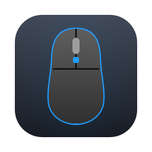

<p align="center"></p>

# G300s Configurator

Configure a **Logitech G300s** (or G300) gaming mouse without Logitech's software, which is no longer
available. Remap the 9 buttons, set the DPI steps, report rate and light colour for each of the
3 profiles, and save it all **to the mouse itself**. Once it's set up, the mouse keeps working the
same way on any computer, with no driver installed.

It comes in two forms:

- **A Mac app**: a picture of your mouse, click a button and choose what it does in plain words
  (Left click, Back, Speed up, Copy ⌘C…), or record any keyboard shortcut. Includes Logitech's
  original factory presets.
- **A command-line tool** (`g300.py`) for scripting, backups and other platforms.

> Tested on macOS with a G300s. Not affiliated with or endorsed by Logitech.

## Mac app

**Requirements:** macOS 11 or later, and Apple's command line tools (they provide Python 3 and the
Swift compiler). If you don't have them, run `xcode-select --install`.

```bash
git clone https://github.com/civelasco/g300s-configurator.git
cd g300s-configurator
macos/build.sh
```

This installs **G300s Configurator** into `~/Applications`, so it appears in Launchpad and Spotlight.

**First launch:** macOS asks to let the app *receive keystrokes*. That's macOS's name for access to
keyboard and mouse devices (Input Monitoring), which the app needs to talk to the mouse. It doesn't
read your typing. Allow it in **System Settings → Privacy & Security → Input Monitoring**, then reopen
the app. The app has buttons for both steps if it can't reach the mouse.

Then:

1. Pick a profile at the top. Empty profiles offer presets, including Logitech's originals.
2. Click a button on the mouse picture (or press it on your real mouse to find it) and choose what
   it does.
3. Set the pointer speed steps (★ = starting speed) and the light colour.
4. Press **Save to mouse**. It takes a couple of seconds per profile.

Before every save, the previous settings are backed up to `~/.g300/backups/`.

## Command line

Works anywhere Python 3 and [hidapi](https://pypi.org/project/hidapi/) do:

```bash
pip3 install -r requirements.txt

python3 src/g300.py show                   # see all 3 profiles
python3 src/g300.py backup my-mouse.json   # do this first
python3 src/g300.py set -p 1 --dpi 500,1000,1500,2500 --default-dpi 2 --rate 1000 --color cyan
python3 src/g300.py bind -p 1 G6 dpi-cycle
python3 src/g300.py bind -p 1 G9 key:cmd+c
python3 src/g300.py activate 2             # switch profile
python3 src/g300.py keys                   # every action and key name you can bind
python3 src/g300.py restore my-mouse.json
```

Add `-n` to `set`, `bind`, `restore` or `reset` for a dry run. Without the Mac app you can also run
the point-and-click page in a browser: `python3 src/g300_gui.py` (or `--demo` for a simulated mouse).

On macOS, the terminal app you use needs Input Monitoring permission too. On Linux, you'll likely
need a udev rule giving your user access to `/dev/hidraw*` for `046d:c246` (untested).

## What you can set

| Setting | Options |
|---|---|
| Profiles | 3, switchable from a mouse button or the app |
| DPI | 4 levels per profile, 250–2500 in steps of 250, one marked as default |
| Report rate | 125, 250, 500, 1000 Hz |
| Light | off, red, green, blue, yellow, cyan, magenta, white |
| Buttons G1–G9 | left / right / middle click, back, forward, mouse buttons 6–9, DPI up / down / cycle / shift / default, next profile, disabled, or any key with modifiers |

Button positions (front of the mouse at the top): G1/G2 are the main buttons, G3 is the wheel
click, G4/G5 are on the left edge (rear/front), G6/G7 on the right edge (rear/front), and G9/G8 sit
behind the wheel (front/rear).

## How it works

The G300s stores its settings in onboard memory and exposes them as USB HID *feature reports*. The
format comes from [libratbag](https://github.com/libratbag/libratbag)'s `logitech_g300` driver
(USB ID `046d:c246`, shared by the G300 and G300s):

| Report | Size | Contents |
|---|---|---|
| `0xF0` | 4 | active profile (bits 4–7) and DPI level (bits 1–3); written to switch either |
| `0xF1` | 2 | current light colour |
| `0xF3`–`0xF5` | 35 | profiles 1–3: light (3 bits), report rate, 4 DPI bytes (value×250, bit 7 = default), one unknown byte, then 9 × 3-byte buttons (action code, modifier mask, HID key usage) |

Things I learned getting it working on macOS, which may help anyone else poking at this mouse:

- The reports are declared on **interface 1** (vendor collection `0xFF80`). Interface 0 answers
  reads, but rejects writes with a USB stall (`IOHIDDeviceSetReport` error `0xE0005000`).
- hidapi opens devices **exclusively** on macOS by default, which fails on interface 1 (it's also
  a keyboard). `g300.py` switches it to shared mode.
- The mouse writes profiles to flash **slowly**. Reading back immediately returns the old data, and
  sending another write too soon can corrupt the profile. The tool waits 2 s after each write.
- A button with action code `0` and no key really is disabled. A mouse with left/right click
  stored as `0` won't click.
- macOS ties the Input Monitoring permission to the app's exact code signature. The Mac app is
  ad-hoc signed, so `macos/build.sh` keeps the Python/HTML in
  `~/Library/Application Support/G300s Configurator` and only rebuilds the app when its Swift code
  changes. That way updates don't reset the permission.

## Project layout

```
src/g300.py            protocol + command-line tool
src/g300_gui.py        local web server behind the point-and-click interface
src/g300_gui.html      the interface
macos/main.swift       native Mac window that runs the above
macos/make_icon.swift  draws the app icon
macos/build.sh         builds and installs the Mac app
tests/                 tests against a simulated mouse:  python3 -m unittest discover tests
```

## Troubleshooting

- **"Can't reach your mouse"**: check Input Monitoring is on for the app (or your terminal). If it
  is on but still fails after a rebuild, remove the entry with **−**, add it again with **+**, and
  reopen the app. A restart clears any stale permission cache in macOS.
- **The mouse stopped clicking**: you've probably switched to a profile whose buttons are disabled.
  Use the app to give that profile a preset, or `python3 src/g300.py restore` a backup.

## Credits

Protocol details from [libratbag](https://github.com/libratbag/libratbag). Button positions and
factory presets from Logitech's G300s setup guide. Logitech and G300s are trademarks of Logitech.
Use at your own risk; the tool backs up your settings before every change.

## License

[MIT](LICENSE)
